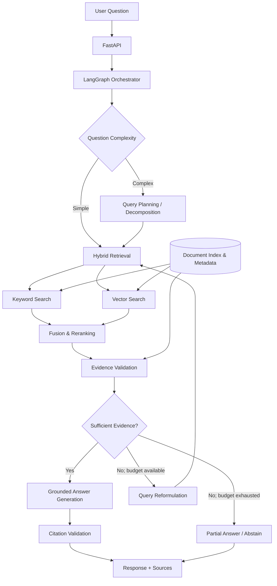

# Enterprise Knowledge Agent

> **EnterpriseRAG-Bench 기반 사내 지식 검색 Agentic RAG 시스템**
>
> **구현 상태** · Phase 1 데이터 수집, Phase 2 검색·평가, Phase 3 출처 기반 답변을 구현했습니다. CLI와 HTTP API에서 답변의 각 주장을 원본 문서의 인용 구간까지 추적할 수 있습니다. LangGraph 기반 다단계 검색은 Phase 4입니다.

[워크플로우와 검증 그래프 보기 (HTML)](experiments/workflow-report.html) · 파일을 내려받아 브라우저에서 열면 수집·답변 단계와 표본 실험 결과를 살펴볼 수 있습니다.

## Overview

**Enterprise Knowledge Agent**는 기업의 여러 내부 데이터 소스에 흩어진 지식을 검색하고, 근거 문서를 확인한 뒤, **출처가 명확한 답변**을 제공하기 위한 프로젝트입니다. [EnterpriseRAG-Bench](https://github.com/onyx-dot-app/EnterpriseRAG-Bench)의 합성 기업 데이터로 일반 RAG와 Agentic Retrieval을 비교·평가합니다.

기본 RAG는 한 번 검색한 결과로 답변을 생성합니다. 이 프로젝트의 **Agentic RAG**는 질문의 복잡도를 분석하고, 필요 시 하위 질문으로 분해하거나 검색어·검색 도구를 변경하여 추가 근거를 수집합니다.

**Scope**

- **포함:** Enterprise Search, Hybrid Retrieval, Multi-step Retrieval, Query Planning, Evidence Validation, Source Citations, Reproducible Evaluation
- **제외 (초기 범위):** 개인화 학습 계획, 직원 온보딩 진척도 관리, 실제 사내 시스템에 대한 쓰기 작업, 운영 환경의 완전한 권한 관리

### Example questions

- "지난 분기 inference latency 이슈의 원인과 해결 과정을 설명해 줘."
- "프로젝트의 API 변경 사항은 어디에서 결정됐고, 어떤 문서가 이를 뒷받침하나요?"
- "Slack 논의와 GitHub PR 사이에 결정 사항이 달라진 부분이 있나요?"

위 문장은 **사용 사례 예시**이며, 실제 벤치마크 질문이나 특정 사건의 존재를 보증하지 않습니다.

## Design Principles

1. **Baseline first** — 에이전트 도입 전 재현 가능한 검색 및 RAG Baseline을 구축합니다.
2. **Evidence over fluency** — 근거가 부족하면 추측하는 대신 불확실성을 명시하거나 답변을 보류합니다.
3. **Traceability** — 질문, 검색 도구 호출, 문서 ID, 인용, 최종 답변을 추적할 수 있게 합니다.
4. **Separation of concerns** — 인덱싱, 검색, 오케스트레이션, 검증, 생성, 평가를 분리합니다.
5. **Bounded agency** — 검색 재시도, 토큰, 시간, 비용에 명시적 한도를 둡니다.
6. **Reproducibility** — 데이터 버전, 인덱스 설정, 모델, 프롬프트 및 평가 조건을 기록합니다.

## System Architecture (Target)

초기에는 다수의 독립 LLM 에이전트보다 **Single LangGraph Orchestrator + Specialized Retrieval Tools + Deterministic Validators** 구성을 채택합니다.



### Main components

| Component | Responsibility |
| --- | --- |
| **Ingestion** | 원본 문서 파싱, 정규화, Chunking, 인덱싱 |
| **Keyword / Vector Retrievers** | 키워드 및 의미 기반 후보 문서 검색 |
| **Hybrid Fusion & Reranking** | 후보 통합, 중복 제거, 최종 순위 조정 |
| **Query Planner** | 복잡한 질문 분해 및 추가 검색 계획 |
| **Orchestrator** | 조건부 분기, 검색 도구 호출, 예산·재시도 관리 |
| **Evidence Validator** | 문서 존재, 인용 가능성, 충돌 및 근거 충분성 검사 |
| **Answer Generator** | 검증된 근거에 기반한 답변 생성 |
| **Evaluation Runner** | 조건별 검색·답변 품질, 지연 및 비용 측정 |

> 검색 도구는 일반 Python 서비스로 구현하고, LangGraph는 해당 도구를 **호출·조정**하는 역할만 담당합니다. 결정적 검증과 의미적 판단은 분리합니다.

## Dataset: EnterpriseRAG-Bench

[Onyx EnterpriseRAG-Bench](https://github.com/onyx-dot-app/EnterpriseRAG-Bench)는 가상 기업 *Redwood Inference*를 시뮬레이션한 공개 합성 데이터셋입니다. 약 **51만 개 문서**, **9종 기업 데이터 소스**, **500개 핵심 평가 질문**을 포함합니다. 별도의 **100개 메타데이터 중심 추가 질문**은 핵심 리더보드 평가와 구분됩니다.

주요 데이터 소스는 Slack, Gmail, Linear, Google Drive, GitHub, Jira, Confluence, HubSpot, Fireflies입니다.

### Data access

- [GitHub — Official repository](https://github.com/onyx-dot-app/EnterpriseRAG-Bench)
- [GitHub — Releases](https://github.com/onyx-dot-app/EnterpriseRAG-Bench/releases)
- [Hugging Face — Dataset](https://huggingface.co/datasets/onyx-dot-app/EnterpriseRAG-Bench)
- [Official Quickstart](https://github.com/onyx-dot-app/EnterpriseRAG-Bench/blob/main/quickstart.md)

공식 GitHub 배포 파일의 `all_documents.zip`은 소스별 디렉터리 구조를 보존하며, 소스별 slice ZIP도 제공됩니다. 문서 파일명은 `dsid_*` 식별자로 시작합니다. Hugging Face 배포본의 `documents` 설정에는 `doc_id`, `source_type` 등의 필드가 포함됩니다. 설치한 데이터의 배포 형식에 따라 아래 입력 경로를 선택합니다.

### Data handling rules

- 원본 문서의 `dsid_*`를 변경하지 않고 보관합니다.
- 검색용 `chunk_id`와 원본 `document_id`를 구분합니다.
- 가능한 경우 소스 종류·문서 제목·경로·시간 메타데이터를 보존합니다.
- 원본 데이터·생성된 인덱스·비밀키는 Git에 커밋하지 않습니다.
- 벤치마크의 `gold_answer`, `answer_facts`, `expected_doc_ids`는 **평가 전용**으로 관리하며 런타임 검색 에이전트에 노출하지 않습니다.
- 일부 질문 유형은 정답 문서 ID가 비어 있을 수 있으므로, 문서 Recall의 평가 대상과 제외 규칙을 사전에 명시합니다.
- 합성 데이터에 실제 조직 권한 정보가 있다고 가정하지 않습니다. 실데이터와 연결하는 단계에서는 **검색 전 접근 제어**가 필요합니다.

### 지원하는 데이터 형식

| 입력 | 파서가 읽는 값 |
| --- | --- |
| `generated_data/sources/<source>/**/*.json` | `dataset_doc_uuid`, `title_field_name`, `content_field_names` 및 원본 메타데이터 |
| 압축을 푼 공식 TXT 배포본 | `dsid_*__이름.txt`의 ID, 첫 줄의 제목, 빈 줄 다음의 본문. 단일 소스의 평면 디렉터리는 `--source-type`으로 지정 |
| Hugging Face 문서 Parquet 파일 | `doc_id`, `source_type`, `content`, 선택적 `title` 및 추가 열. `uv sync --extra parquet`로 설치 |

예를 들어 Gmail은 `subject`와 `body`, Slack은 `channel`과 `messages`를 제목·본문으로 지정할 수 있습니다. 원본 JSON의 복수 본문 필드는 지정 순서로 결합합니다. `first_email_at`, `thread_ts`, 참여자, 라벨 등 나머지 필드는 JSONB에 원래 이름과 타입으로 보존합니다. 제목을 읽을 수 없으면 `null`을 저장합니다. 본문 필드 지정자가 손상된 경우 알려진 본문 키를 확인합니다. 빈 본문은 문서만 저장합니다.

## 구현 구조

| 경로 | 역할 |
| --- | --- |
| `src/enterprise_agent/models.py` | Pydantic 문서, 청크, 검색 결과와 필터 |
| `src/enterprise_agent/ingestion/` | 스트리밍 로더, 정규화, 문자 단위 청크 분할, 배치 수집 |
| `src/enterprise_agent/storage/` | PostgreSQL 스키마, 멱등 저장, pgvector 캐시, 검색 SQL과 코퍼스 스냅샷 |
| `src/enterprise_agent/embeddings.py` | 공통 임베딩 인터페이스, Model2Vec 및 OpenAI 어댑터 |
| `src/enterprise_agent/retrieval/` | 공통 `search(query, k, filters)` 인터페이스와 RRF |
| `src/enterprise_agent/generation/` | 검색 1회, 근거 선택, 구조화된 답변 생성, 부분 답변·보류 판정 |
| `src/enterprise_agent/validation/` | 인용할 원문 구간과 요청별 ID 구성, 권한·위치 대조, 로컬 자연어 추론(NLI) 모델로 주장과 반대 근거 검토 |
| `src/enterprise_agent/api.py` | CLI와 같은 답변 파이프라인을 사용하는 FastAPI `POST /answer` |
| `src/enterprise_agent/evaluation/` | 평가 전용 질문 로딩, 원본 문서 단위 지표, JSON 보고서 |
| `src/enterprise_agent/cli.py`, `tests/` | CLI 진입점, 단위 및 PostgreSQL 통합 테스트 |

## Getting Started

### 1. 환경과 데이터베이스

Python 3.11 이상과 `uv`가 필요합니다. 아래 명령은 로컬 개발용 PostgreSQL 17과 pgvector를 설치하고 스키마를 초기화합니다. 기본 Compose 포트는 `127.0.0.1:55432`입니다.

```bash
uv sync --locked --python 3.11 --all-extras
cp -n .env.example .env
docker compose up -d --wait db
uv run enterprise-agent init-db
```

기존 PostgreSQL을 사용하려면 서버에 pgvector 확장을 설치하고 전용 빈 데이터베이스를 준비한 뒤, `.env`의 `DATABASE_URL`을 지정하고 `init-db`를 실행합니다. 초기화 계정에는 테이블과 `vector` 확장을 만들 권한이 필요합니다. 통합 테스트는 `TEST_DATABASE_URL`에 임시 스키마를 만들고 실행 후 제거합니다.

### 2. 데이터 준비와 수집

이 체크아웃에서는 `EnterpriseRAG-Bench/generated_data/sources/`를 바로 사용할 수 있습니다. 다른 환경에서는 공식 배포본을 `data/raw/`에 풀고, 아홉 소스 디렉터리의 상위 경로나 단일 소스 경로를 `--input`에 넣습니다. 질문 JSONL은 평가 명령에서만 지정합니다.

```bash
uv run enterprise-agent ingest --input EnterpriseRAG-Bench --limit 180 --batch-size 32 --chunk-size 1200 --overlap 160
uv run enterprise-agent build-index --kind keyword
uv run enterprise-agent build-index --kind dense --max-chunks 1248 --batch-size 48
```

- 수집 기본 한도는 입력 레코드 100개입니다. 로더는 소스별 파일과 하위 디렉터리를 정렬하고 소스들을 번갈아 읽습니다. 전체 수집은 `--all-documents`로 명시합니다. `--lexical-index`를 수집 명령에 붙이면 FTS GIN 인덱스도 생성합니다.
- 청크는 유니코드 문자 기준이며 `[start_offset, end_offset)`으로 원문과 대조할 수 있습니다. ID는 원본 `dsid_*`, 시작 위치, 본문 SHA-256으로 구성합니다. 부모 문서 메타데이터는 검색 시 조인합니다.
- 배치 단위로 커밋하고 파일 경로와 오류를 기록합니다. 경로가 다른 문서가 같은 ID를 사용하면 충돌로 보고합니다. JSON 통계의 `seen`, `written`, `unchanged`, `errors`는 문서 수이고 `chunks_written`은 이번에 저장한 문서들의 청크 수입니다. 오류가 있으면 CLI가 종료 코드 1을 반환합니다.
- 임베딩은 별도 명령으로 실행합니다. `--max-chunks`는 호출당 새로 임베딩할 최대 청크 수이며 기본값은 100입니다. 모델·리비전·차원·청크 ID가 일치하면 재사용합니다. 변경된 본문을 재수집하면 오래된 청크와 해당 임베딩을 함께 정리합니다.

기본 의미 검색 모델은 `minishlab/potion-base-8M`(256차원)입니다. 첫 실행에 고정 리비전의 가중치를 내려받고 로컬 CPU에서 인코딩합니다. 캐시를 준비한 뒤 `HF_HUB_OFFLINE=1`로 실행할 수 있습니다. OpenAI 사용 시 `uv sync --extra openai` 후 `.env`에 `EMBEDDING_PROVIDER=openai`, `EMBEDDING_MODEL=text-embedding-3-small`, `EMBEDDING_DIMENSIONS=1536`, 빈 `EMBEDDING_REVISION=` 및 `OPENAI_API_KEY`를 설정합니다. 인덱싱과 질의 인코딩에 해당 계정 요금이 적용됩니다. 평가에서는 질문당 C1·C2가 각각 한 번 질의를 인코딩합니다.

### 3. 검색

```bash
uv run enterprise-agent search 'customer invoice payment status' --method keyword --top-k 5
uv run enterprise-agent search 'customer invoice payment status' --method dense --source-type gmail --top-k 5
uv run enterprise-agent search 'customer invoice payment status' --method hybrid --candidates 50 --rrf-constant 60 --top-k 5
uv run enterprise-agent search 'quarterly forecast' --source-type gmail --metadata '{"region":"us"}'
```

세 방식 모두 청크 본문과 원본 문서 ID, 청크 ID, 위치, 소스, 경로, 제목, 메타데이터, 점수와 순위를 JSON으로 반환합니다. `component_ranks`에는 해당 청크를 반환한 검색기별 순위가 들어갑니다. 키워드 검색은 PostgreSQL 영어 FTS와 `ts_rank_cd`를 사용하고 제목에 더 큰 가중치를 줍니다. 벡터 검색은 정확한 코사인 유사도를 사용합니다. 하이브리드는 각 후보 목록에 대해 `1 / (rrf_constant + 순위)`를 더하고 청크 ID로 중복을 제거합니다.

### 4. 출처를 포함한 답변

수집을 마친 DB와 구조화된 JSON 출력을 지원하는 생성 모델이 필요합니다. 아래 명령은 검증에 사용한 Qwen2.5-1.5B-Instruct Q4_K_M 가중치(약 1.12 GB)를 준비합니다. `llama-server`를 설치한 뒤 별도 터미널에서 서버를 실행합니다. [모델 파일](https://huggingface.co/Qwen/Qwen2.5-1.5B-Instruct-GGUF/tree/91cad51170dc346986eccefdc2dd33a9da36ead9) · [검증한 llama.cpp 릴리스](https://github.com/ggml-org/llama.cpp/releases/tag/b7712)

```bash
uv run --locked hf download Qwen/Qwen2.5-1.5B-Instruct-GGUF qwen2.5-1.5b-instruct-q4_k_m.gguf \
  --revision 91cad51170dc346986eccefdc2dd33a9da36ead9 --local-dir data/models
llama-server -m data/models/qwen2.5-1.5b-instruct-q4_k_m.gguf \
  --alias local-model --host 127.0.0.1 --port 8080 -c 8192 -np 1
```

프로젝트의 `.env`에 아래 값을 설정합니다. `ANSWER_ACCESS_SCOPE`는 이 인스턴스에서 열람할 수 있는 소스를 지정합니다. 특정 문서만 허용하려면 같은 JSON에 `"document_ids":["dsid_…"]`를 추가하고 실제 원본 ID를 넣습니다. 비어 있는 허용 목록으로 시작하면 답변을 보류합니다.

```dotenv
ANSWER_PROVIDER=local
ANSWER_BASE_URL=http://127.0.0.1:8080/v1
ANSWER_MODEL=local-model
ANSWER_ACCESS_SCOPE='{"source_types":["linear","gmail"]}'
```

```bash
uv run --locked --extra answer enterprise-agent answer \
  'On which two Redwood Console pages is the shift-change companion drawer available?' \
  --method hybrid --source-type linear --top-k 3

uv run --locked --extra api --extra answer uvicorn enterprise_agent.api:app --host 127.0.0.1 --port 8000
```

```bash
curl -sS http://127.0.0.1:8000/answer \
  -H 'Content-Type: application/json' \
  -d '{"question":"Which pages host the shift-change companion drawer?","method":"keyword","top_k":3,"source_type":"linear"}'
```

두 진입점은 같은 출력 계약을 사용합니다. 기본 검색 방식은 `hybrid`이고, `keyword`는 임베딩 인덱스 없이도 사용할 수 있습니다. `source_type`과 `metadata`로 허용 범위 안의 문서를 더 좁힐 수 있습니다. 호스팅된 OpenAI를 선택하려면 `ANSWER_PROVIDER=openai`, 구조화된 출력을 지원하는 `ANSWER_MODEL`, `OPENAI_API_KEY`를 설정합니다. 이 설정은 질문과 허용된 발췌문을 해당 서비스로 전송하며 사용 요금이 발생할 수 있습니다. 로컬 생성에도 같은 Python SDK를 사용합니다.

| 응답 필드 | 읽는 방법 |
| --- | --- |
| `status`, `answer` | `answered`는 답변, `partial`은 확인된 부분만 포함한 답변, `abstained`는 보류이며 이때 `answer`는 `null` |
| `claims[].kind`, `text`, `citations` | 사실(`fact`)과 추론(`inference`)별 근거. 각 인용은 원본 `document_id`, `chunk_id`, 소스, 경로, 제목, 발췌문, 위치를 포함 |
| `start_offset`, `end_offset` | 정규화된 원본 문서의 유니코드 문자 위치. `document.content[start_offset:end_offset]`으로 `quote`를 복원 |
| `conflicts`, `limitations` | 상충한다고 판정한 두 근거의 인용과 부분 답변·보류 사유 |
| `generation` | 생성 제공자, 모델, 프롬프트 버전, 제공자가 보고한 입출력 토큰 수. 생성 호출을 생략하면 `null` |

검색 전에 소스·문서 허용 목록을 적용합니다. 생성 직전에 PostgreSQL에서 청크와 원문 구간을 대조하고, 모델에는 질문과 요청별 ID가 붙은 발췌문만 보냅니다. 생성 후에는 전달했던 모든 청크를 다시 읽습니다. 그 사이 문서가 삭제·수정되거나 허용 범위에서 사라지면 전체 답변을 보류합니다. 답변 한 건의 상한은 질문 4,000자, 검색 청크 20개, 근거 본문 6,000자, 생성 1회, 출력 1,200토큰입니다. 생성 제공자 연결 오류는 CLI 종료 코드 1 또는 HTTP 503으로 전달됩니다.

생성된 각 주장은 별도 모델이 인용 구간과 대조합니다. 인용에 실제로 등장하는 숫자와 영문 대문자 약어, 주장을 지지하는 발췌문, 같은 검색 결과 안의 반대 근거를 검사합니다. `unsupported_claim`은 이 검사를 통과하지 못한 주장이 있다는 뜻입니다. NLI 검증기는 고정 리비전의 mDeBERTa 양자화 모델(약 339 MB)을 처음 사용할 때 캐시에 내려받고 CPU에서 실행합니다. 오프라인 실행은 아래 명령으로 검증기를 준비하고, 사용할 검색 모델도 미리 받은 뒤 `HF_HUB_OFFLINE=1`을 설정합니다. [검증 모델](https://huggingface.co/MoritzLaurer/mDeBERTa-v3-base-mnli-xnli)

```bash
uv run --locked hf download MoritzLaurer/mDeBERTa-v3-base-mnli-xnli \
  config.json tokenizer.json onnx/model_quantized.onnx --revision 8adb042d524ecd5c26d3e3ba0e3fbcf7e2d0864c
```

### 5. 평가와 테스트

```bash
uv run enterprise-agent evaluate --questions EnterpriseRAG-Bench/questions.jsonl --limit 500 --dataset-version d36685e273713975ee20299bbf1ab64165575b3c --chunk-depth 50 --candidates 50 --rrf-constant 60 --output experiments/results/phase2-sample180.json
uv run --all-extras pytest -q
```

위 데이터 버전은 검증에 사용한 벤치마크 커밋입니다. 다른 버전에서는 자신의 체크아웃이나 배포 식별자를 지정합니다. 평가기는 세 검색기를 같은 읽기 전용 DB 스냅샷에서 실행합니다. 선택한 모델이 모든 청크를 인덱싱했는지 확인하고, 코퍼스·질문 파일 해시, 청크 설정, 모델 리비전, 후보 수, 질문별 검색 순위·점수·소요 시간을 JSON에 저장합니다. 질문 원문만 검색기에 전달합니다.

후보 청크를 순위순으로 읽고 각 원본 문서의 첫 등장만 남긴 뒤 Recall@1/5/10과 MRR을 계산합니다. MRR은 후보 안에서 첫 정답 문서의 역순위입니다. 정답 문서 ID가 없는 질문은 Recall과 MRR 집계에서 제외하며, 평균 검색 지연과 평균 고유 문서 수에는 포함합니다. 후보 깊이가 50인 경우 여러 청크가 같은 문서를 가리켜 고유 문서 수가 50보다 작아질 수 있습니다.

### 실제 표본 검증 결과

9개 소스에서 20개씩 수집한 문서 180개로 1,248개 청크를 생성했습니다. 같은 설정으로 재수집했을 때 변경 문서와 새 임베딩은 모두 0개였습니다. PostgreSQL 17.11과 pgvector 0.8.2에서 공식 질문 500개를 실행했습니다. 정답 ID가 있는 470개 중 표본에 정답 문서가 하나라도 있는 질문은 24개였습니다. 표본 밖 정답도 Recall 분모에 포함합니다.

| 방식 | Recall@1 | Recall@5 | Recall@10 | MRR | 평균 지연(ms) | 평균 고유 문서 수 |
| --- | ---: | ---: | ---: | ---: | ---: | ---: |
| C0 FTS | 0.0298 | 0.0340 | 0.0386 | 0.0345 | 19.74 | 13.49 |
| C1 벡터 | 0.0223 | 0.0351 | 0.0418 | 0.0302 | 6.11 | 29.76 |
| C2 RRF | 0.0340 | 0.0407 | 0.0418 | 0.0394 | 23.50 | 23.48 |

같은 설정으로 평가를 반복했을 때 1,500개 질문·검색 방식 조합의 청크 순위, 점수와 문서 지표가 모두 일치했습니다. 단위 및 PostgreSQL 통합 테스트 22개가 통과했습니다. OpenAI 어댑터는 모의 응답으로 검증했고, 위 측정에는 로컬 Model2Vec을 사용했습니다.

질문별 전체 결과의 기본 예시 경로는 `experiments/results/phase2-sample180.json`입니다. 재검증 보고서에는 같은 표본을 빈 DB에 다시 수집한 결과와 세 검색 방식의 독립 검산 방법을 기록했습니다. [최초 평가 설정과 결과 요약](experiments/phase2-sample180-summary.json) · [Phase 1·2 재검증 보고서](experiments/phase1-2-verification.md)

Phase 3에서는 같은 표본 DB와 로컬 생성 모델로 CLI 및 HTTP 요청을 실행하고, 반환된 인용 위치를 원본 JSON과 대조했습니다. [Phase 3 검증 방법과 결과](experiments/phase3-verification.md)

## Retrieval & Answering Policy

1. 사용자의 질문과 필요 메타데이터를 분석합니다.
2. Keyword / Vector 검색에서 후보 Chunk를 수집합니다.
3. RRF 등으로 결합하고 상위 문서를 재정렬합니다.
4. `chunk_id`를 `document_id`로 연결하며 원문 근거를 보존합니다.
5. 복잡한 질문이거나 근거가 부족하면 **한도 내에서** 검색어를 수정해 재검색합니다.
6. 검증된 문서에 근거하여 답변하며, 문서 ID와 가능하면 해당 근거 위치를 인용합니다.
7. 근거가 없거나 충돌을 해결할 수 없으면 이를 명시하고 추측하지 않습니다.

> 검색 문서는 **신뢰할 수 없는 입력 데이터**입니다. 문서 내 지시문이 시스템 규칙이나 도구 권한을 변경할 수 없습니다.

## Evaluation Plan

### Experiment conditions

| Condition | Retrieval | Agentic Planning / Retry | Purpose |
| --- | --- | --- | --- |
| **C0** | PostgreSQL FTS (`ts_rank_cd`) | Off | 어휘 기반 Baseline |
| **C1** | Dense Vector | Off | 의미 검색 Baseline |
| **C2** | Hybrid (RRF) | Off | 강한 Non-agentic Baseline |
| **C3** | Hybrid 기반 Agentic Retrieval (Phase 4 예정) | On | Agentic Retrieval 추가 효과 측정 |

모든 조건은 가능한 한 동일한 corpus snapshot, 인덱싱 정책, 응답 생성 모델, 평가 입력을 사용합니다. **C2와 C3의 차이**로 추가 Query Planning / Adaptive Retrieval의 효과를 분석합니다.

### Metrics

| Category | Metrics |
| --- | --- |
| Retrieval | Document Recall@k, MRR, optional nDCG@k |
| Answer quality | Correctness, Completeness |
| Grounding | Citation validity, unsupported-claim rate, abstention behavior |
| Agent behavior | Retrieval recovery rate, tool calls, retry counts |
| Efficiency | End-to-end latency, token usage, estimated API cost |

**Document Recall@k**는 정답 문서 ID 집합 대비 상위 k개 *고유 원본 문서*의 Recall입니다. 정답 문서 ID가 없는 질문은 이 지표에서 제외하거나 별도 범주로 평가합니다.

**Retrieval recovery rate**는 1차 검색에서 실패한 질문 중 **gold 정답을 런타임에 참조하지 않고** 추가 검색으로 충분한 근거를 수집한 비율을 사후 분석으로 집계합니다.

공식 벤치마크의 평가는 [Quickstart](https://github.com/onyx-dot-app/EnterpriseRAG-Bench/blob/main/quickstart.md)에 안내된 Correctness, Completeness, Document Recall, Invalid Extra Documents도 함께 보고합니다. 공식 리더보드의 **Overall Score**는 질문별 `correctness × completeness`의 평균이며, 자체 실험 지표와 구분해 표기합니다.

### Evaluation integrity

- 평가 질문 및 gold label을 에이전트의 프롬프트나 검색 인덱스에 섞지 않습니다.
- 개발 중 설정을 조정하는 **development set**과 최종 측정을 위한 **held-out set**을 분리합니다.
- `model`, `embedding_model`, `index_version`, `top_k`, `chunk_size`, `retry_budget`, `prompt_version`, `dataset_version` 등을 실행 결과와 함께 저장합니다.
- 정확성 향상뿐 아니라 비용 및 지연 증가도 함께 보고합니다.

## Implementation Roadmap

**Phase 1~3 완료** · 표본 DB에서 수집·검색·출처 기반 답변의 종료 기준을 검증했습니다. 다음 단계는 Phase 4의 다단계 검색입니다.

### Phase 1 — Dataset Ingestion & Foundation

- [x] Python 프로젝트 초기화 (`uv`, `pyproject.toml`, 테스트 환경)
- [x] 데이터셋 형식 확인 및 소규모 샘플 로딩
- [x] `Document` / `DocumentChunk` 타입과 메타데이터 계약 정의
- [x] 정규화, 결정적 Chunking 및 문서 ID 보존
- [x] 인덱스 빌드·재빌드 파이프라인 및 테스트 작성

**Exit criteria:** 소량 문서를 반복 가능한 방식으로 수집·인덱싱하고, 검색 Chunk에서 원본 `dsid_*`까지 추적 가능.

### Phase 2 — Baseline RAG & Retrieval

- [x] PostgreSQL FTS 기반 Keyword Search 구현
- [x] Dense Vector Search 구현
- [x] Hybrid Retrieval 및 RRF 구현 (추가 reranker는 후속 선택 사항)
- [x] 동일한 질문 집합으로 Retrieval 지표 산출
- [x] 실패 사례 및 검색 로그 저장

**Exit criteria:** C0·C1·C2 검색 성능을 동일한 기준으로 재현 가능하게 비교할 수 있음.

### Phase 3 — Grounded Answer Generation

- [x] Evidence 기반 답변 생성 파이프라인
- [x] 문서 ID 및 인용 위치를 포함하는 출력 계약
- [x] 존재하지 않는 인용·권한 위반의 결정적 검증
- [x] 상충하는 근거와 불확실성 처리
- [x] 근거 부족 시 Partial Answer / Abstention 동작 테스트

**Exit criteria:** 검색 결과를 바탕으로 답변하고, 인용 대상 문서가 실제로 존재하는지 검증 가능한 RAG MVP.

### Phase 4 — Agentic Retrieval with LangGraph

- [ ] 단순/복합 질문 분기 및 Query Planning
- [ ] Multi-step Query Decomposition 및 Search Tool Routing
- [ ] 근거 부족 시 Query Reformulation & Retry
- [ ] 최대 재시도·비용·실행 시간 한도 설정
- [ ] State, 실행 트레이스, 실패 원인 및 도구 호출 로그 기록

**Exit criteria:** 복잡한 질문에서 필요할 때만 추가 검색을 수행하며 종료 조건과 실행 기록이 명확한 Agentic RAG.

### Phase 5 — Evaluation & Optimization

- [ ] C0~C3 고정 실험 설정 작성
- [ ] Retrieval / Answer / Citation / Recovery 평가
- [ ] Latency, Token Usage, Cost 및 Tool Calls 분석
- [ ] Ablation Study 및 실패 유형 분석
- [ ] 재현 가능한 결과 보고서와 최종 README 갱신

**Exit criteria:** Agentic Retrieval이 Baseline 대비 제공하는 성능 개선과 비용을 데이터로 설명할 수 있음.

## Development Workflow with Codex

`AGENT.md`는 **Codex가 이 저장소에서 코드를 수정할 때 따르는 개발 규칙**입니다. Phase 3 런타임 프롬프트와 버전은 `src/enterprise_agent/generation/prompt.py`에서 관리합니다.

Codex 작업 시 다음 원칙을 적용합니다.

1. `AGENT.md`와 README의 해당 Phase 지침을 먼저 확인합니다.
2. 한 Phase의 작은 단위로 기능을 구현합니다.
3. 기존 모듈 경계를 유지하고 관련 Unit Test를 추가합니다.
4. 실행한 테스트와 실행하지 못한 테스트를 구분하여 보고합니다.
5. 검증 전에는 기능을 **Implemented**로 표시하지 않습니다.

## Limitations & Security

- 위 비교는 문서 180개의 표본 실험입니다. 전체 코퍼스 성능과 전체 규모의 처리량은 추가 측정이 필요합니다. 현재 벡터 검색은 모델별 청크를 정확 탐색하므로 코퍼스 증가에 따라 지연이 커질 수 있습니다.
- TXT와 공개 4열 Parquet 배포본에서 얻을 수 있는 메타데이터는 원본 JSON보다 적습니다. 소스별 작성자·시간 필터가 필요하면 원본 JSON을 선택합니다.
- 현재 수집은 입력에 등장한 문서를 갱신합니다. 원본 디렉터리에서 삭제된 파일의 동기화는 후속 작업입니다. 서로 다른 코퍼스 스냅샷을 비교할 때는 별도의 빈 DB를 사용합니다.

- 이 프로젝트는 **합성 기업 데이터 기반 실험 환경**이며, 실제 기업 서비스에 즉시 배포할 수 있는 권한 시스템을 포함하지 않습니다.
- 합성 문서에서 발견된 조직·인물·의사결정 정보는 상충하거나 오래되었을 수 있습니다.
- Phase 3의 허용 목록은 로컬 단일 사용자 인스턴스 단위로 적용됩니다. 사용자 인증과 조직별 ACL 연동은 운영 전 추가 작업입니다.
- 원문 일치와 열람 범위는 DB에서 확인합니다. 주장의 의미, 답변의 충분성, 의미상 충돌 여부는 생성·검증 모델이 판단합니다. 실제 표본에서도 원문에 답이 있는 질문을 보류한 사례가 있습니다.
- Prompt Injection 방어를 위해 검색 문서 내용을 시스템·개발자 지침으로 실행하지 않습니다.
- 향후 실제 기업 데이터와 연결할 때는 수집 및 검색 계층에서 사용자별 접근 제어(ACL)를 강제하고 별도 보안 평가를 수행해야 합니다.

## References

- [Onyx — EnterpriseRAG-Bench GitHub](https://github.com/onyx-dot-app/EnterpriseRAG-Bench)
- [Official Quickstart & Evaluation Format](https://github.com/onyx-dot-app/EnterpriseRAG-Bench/blob/main/quickstart.md)
- [Dataset Generation Methodology](https://github.com/onyx-dot-app/EnterpriseRAG-Bench/blob/main/methodology.md)
- [Hugging Face Dataset Card](https://huggingface.co/datasets/onyx-dot-app/EnterpriseRAG-Bench)
- [EnterpriseRAG-Bench Paper](https://arxiv.org/abs/2605.05253)

## License

EnterpriseRAG-Bench의 공개 데이터 및 원본 저장소 라이선스는 해당 프로젝트의 [LICENSE](https://github.com/onyx-dot-app/EnterpriseRAG-Bench/blob/main/LICENSE)를 따릅니다. **이 프로젝트 자체의 라이선스는 아직 결정되지 않았습니다.**
